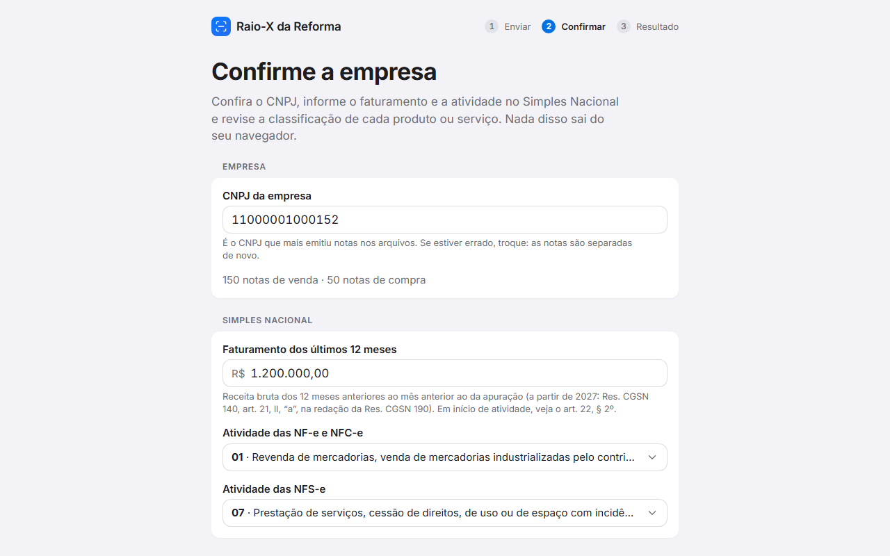
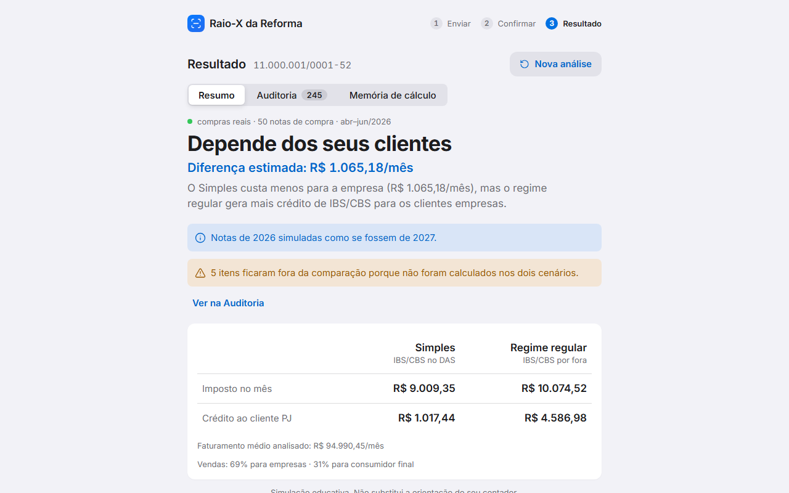
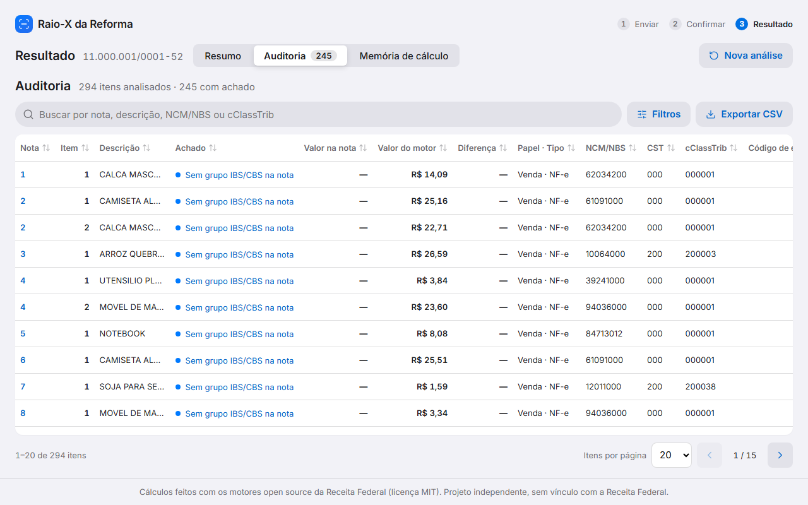

# Raio-X da Reforma

Aplicação web de código aberto que lê os XMLs fiscais da empresa (NF-e, NFC-e e NFS-e nacional, de vendas e de compras) e
usa os **motores de cálculo oficiais da Receita Federal** para responder duas perguntas: as notas estão corretas para o
IBS/CBS (auditoria item a item) e, a partir de 2027, compensa ficar no Simples Nacional ou passar o IBS e a CBS para o
regime regular?

> **Projeto independente, sem vínculo com a Receita Federal.** Simulação educativa; não substitui a orientação do seu contador.

<!-- TODO: gravar o GIF do fluxo completo (enviar → confirmar → resultado) e salvar em docs/demo.gif -->


## Por que existe

A Reforma Tributária do consumo troca PIS, Cofins, ICMS e ISS por CBS e IBS, com início em 2026 e 2027 e transição até 2033.
Para quem está no Simples Nacional, a conta mudou: a empresa pode continuar com IBS/CBS dentro do DAS ou apurá-los por fora,
no regime regular. Nessa escolha entram o crédito que o cliente empresa recebe, o crédito das compras e as faixas do Simples.
Com as notas reais em mãos, dá para simular os dois cenários, em vez de usar uma média genérica.

## Como funciona

```
 navegador (React) ──► Caddy ──► motor regime regular  (IBS/CBS/IS)
   lê os XMLs            │
   e monta a análise     └─────► motor Simples Nacional
```

- **Seus XMLs não saem do navegador.** Eles são lidos e interpretados na própria página; só os valores dos itens
  (base de cálculo, NCM/NBS, classificação) vão ao cálculo. Nada é guardado.
- O Caddy é o único ponto de entrada: serve a interface e encaminha `/motor/regular/...` e `/motor/simples/...` para os motores,
  que ficam numa rede interna e rodam sem nenhuma alteração.
- Fluxo em três passos: **Enviar** (XMLs soltos ou ZIP) → **Confirmar** (CNPJ, faturamento, atividade no Simples e
  classificação IBS/CBS de cada NCM/NBS) → **Resultado** (Resumo com o veredito, Auditoria em tabela com exportação CSV e
  Memória de cálculo).

| Enviar | Confirmar |
|---|---|
|  |  |
| **Resumo** | **Auditoria** |
|  |  |

As telas acima usam notas **sintéticas** (CNPJs e nomes fictícios).

## Como rodar

Requisitos: Docker com Compose v2.17 ou superior.

```bash
docker compose up --build
```

Depois acesse http://localhost:8080. O primeiro build leva vários minutos, porque compila os motores oficiais com Maven; os
seguintes usam o cache do Docker. Só o serviço `web` (Caddy) publica porta no host (HTTP, uso local). Para encerrar:
`docker compose down`.

Detalhes dos motores (commits fixados, banco, portas) em [`motores/README.md`](motores/README.md) e [`docs/spike-motores.md`](docs/spike-motores.md).

## Testes

Todos os comandos rodam dentro de `web/` (`npm ci` uma vez).

| Camada | Comando | Precisa da pilha no ar |
|---|---|---|
| Unitários (Vitest) | `npm test` | não |
| Motores ao vivo | `npm run test:live` | sim |
| Ponta a ponta (Playwright) | `npm run test:e2e` | sim |
| Build | `npm run build` | não |

### Testes ponta a ponta

O teste ponta a ponta usa o navegador de verdade contra os motores reais, com um conjunto de ~200 notas sintéticas geradas
de forma determinística por `web/e2e/gerarNotas.ts` (150 vendas, 50 compras, NCMs com redução, uma combinação NCM × cClassTrib
inválida, duplicadas e um evento de cancelamento). Sequência de comandos:

```bash
docker compose up --build -d          # na raiz do repositório; espere os motores ficarem saudáveis
cd web
npm ci
npx playwright install chromium       # uma vez
npm run test:e2e
cd .. && docker compose down
```

O teste envia o ZIP, confirma a empresa (faturamento de R$ 1.200.000,00, atividades 01 e 07), calcula nos dois motores,
confere o veredito, o `REG-011` na Auditoria, o CSV exportado e as duas origens da Memória de cálculo. As medições de layout
nos 7 tamanhos de tela estão em [`docs/medicao-layout.md`](docs/medicao-layout.md).

## Limitações

- **Imposto Seletivo (IS) não é suportado:** itens com IS ficam fora da comparação e aparecem na Auditoria como não calculados.
- **Memória de cálculo do Simples é composta pelo Raio-X:** o motor do Simples não devolve a memória; a tela a monta a partir da
  resposta dele e a rotula como tal. A do regime regular vem do motor.
- **6ª faixa do Simples:** o cálculo segue uma interpretação do teto de 5% do ISS (Res. CGSN 190, art. 21, III), ainda pendente de
  confirmação; a tela avisa.
- **CBS e IBS somados:** a comparação trata os dois tributos juntos, sem separar as diferenças de cada um. Fórmulas e premissas em [`web/src/simulacao/FORMULAS.md`](web/src/simulacao/FORMULAS.md).
- **Créditos proporcionais à receita incluída:** o crédito das compras é rateado conforme a receita efetivamente incluída no cálculo.
- **Alíquotas de 2027 de referência:** os dados abertos de 2027 ainda não existem (HTTP 404); o cálculo usa alíquotas de
  referência, e notas de 2026 são simuladas como se fossem de 2027.
- **Auditoria das vendas:** os valores recalculados vêm do motor do Simples (o certo para quem é do Simples); a validação de
  CST × cClassTrib × NCM/NBS vem do motor do regime regular, rodado nos mesmos itens, e seus erros (`REG-xxx`) entram na linha da
  venda. O valor destacado na nota (regime regular) pode divergir do valor do Simples por natureza: leia "valor divergente" como
  um ponto de atenção, não como erro da nota.

## Créditos

Os cálculos são feitos pelos motores oficiais da Receita Federal do Brasil, usados sem modificações:

- [calculadora-rtc-regime-regular](https://github.com/ReceitaFederal/calculadora-rtc-regime-regular)
- [calculadora-rtc-simples-nacional](https://github.com/ReceitaFederal/calculadora-rtc-simples-nacional)

Este projeto é independente e não possui vínculo com a Receita Federal do Brasil. Ver [`NOTICE`](NOTICE).

## Licença

[MIT](LICENSE).
